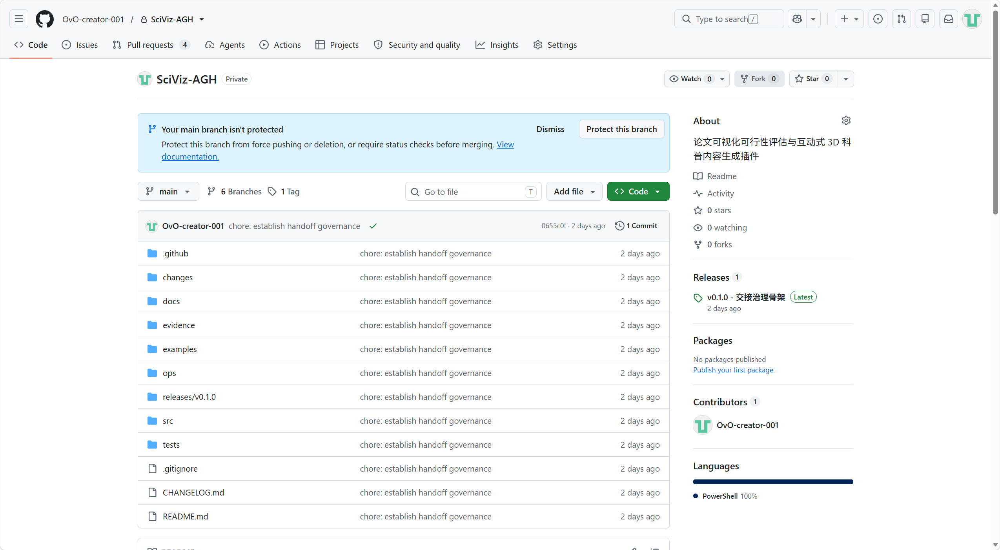

# GitHub 项目内容与截图

- 平台：GitHub。
- 项目链接：https://github.com/OvO-creator-001/SciViz-AGH
- 成品功能介绍：https://github.com/OvO-creator-001/SciViz-AGH/tree/feat/b-research-modes
- 真实内容：SciViz-AGH 论文可视化插件、使用说明、源代码、安装与测试材料。
- 截图：[github仓库图片.png](github仓库图片.png)，由团队提供，原图保留，不修改画面。
- 材料整理日期：2026-10-14；这不是公开发布日期。
- 公开发布日期：尚未确认，不以文件创建时间或代码提交时间代替。

截图记录的是私有仓库及当时的 main 页面，不代表最新成品代码已经合入 main。2026-10-14 整理时，通过 GitHub 查询仓库仍为 PRIVATE。本材料不将私有仓库页面表述为已公开发布内容，也不将代码链接表述为在线生成服务。

项目介绍：SciViz-AGH 将论文分析与交互图解连接起来，提供学术与科普两种阅读层次，以免费、轻量的结构化图形帮助用户理解概念和关系，并保留来源及风险提示。
